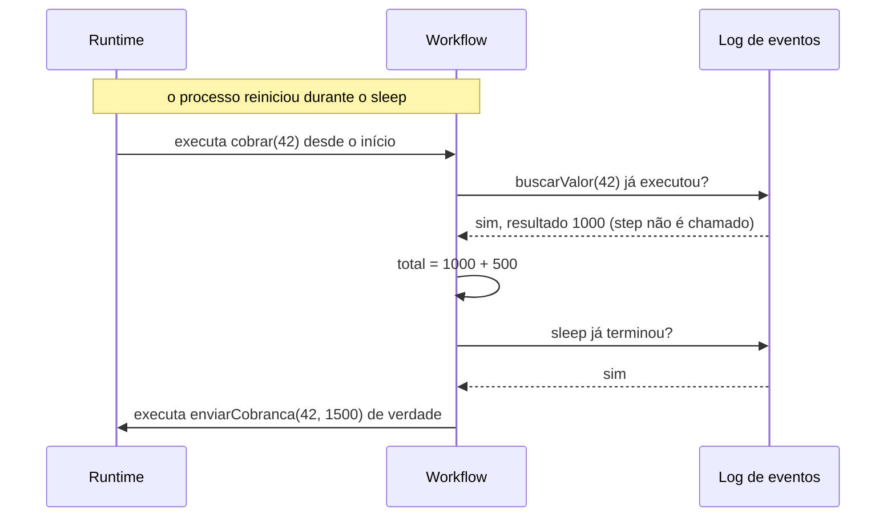
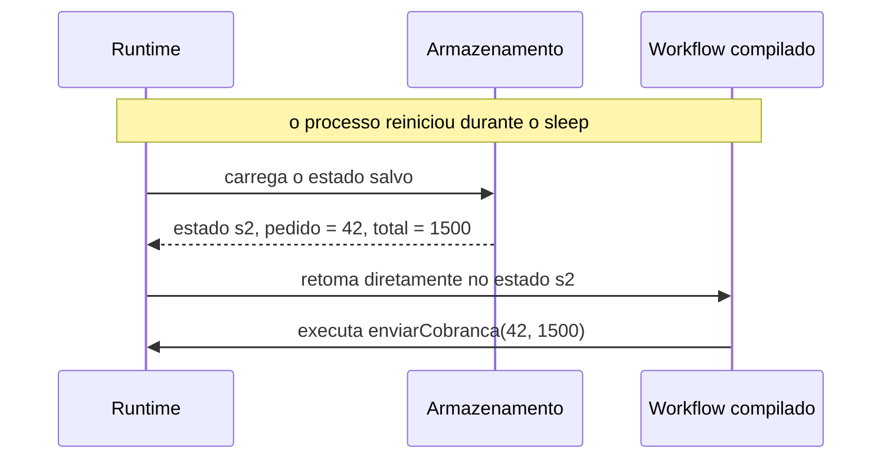
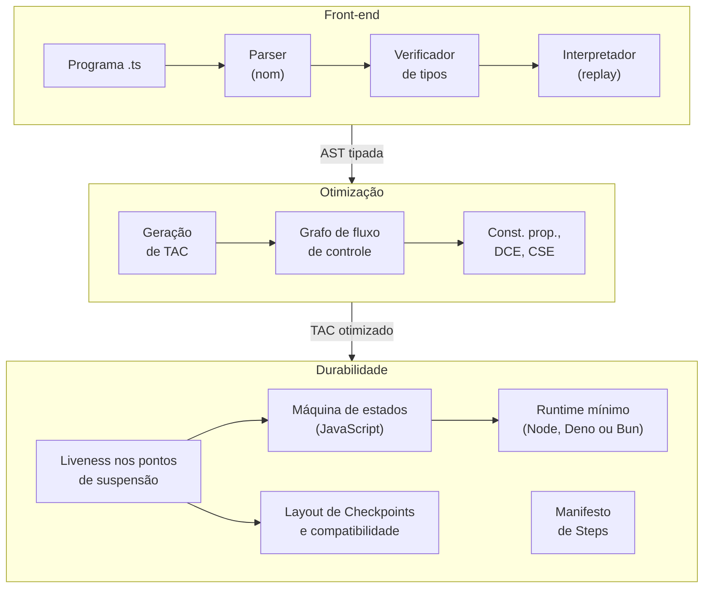
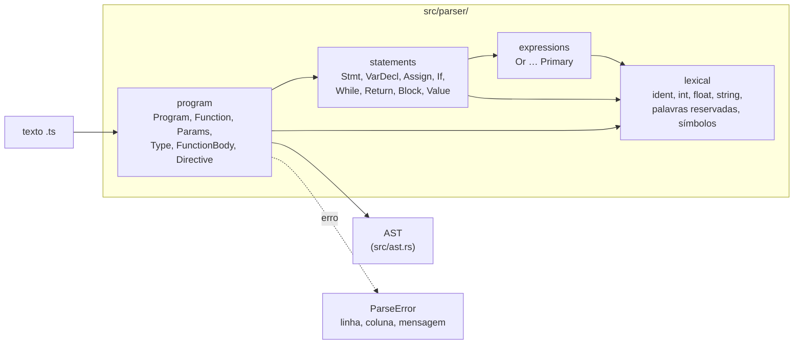

# Dormant: workflows duráveis compilados

> **Documento de design.** Descreve a linguagem, a tese e a arquitetura, e é atualizado conforme a implementação avança. Projeto desenvolvido na disciplina de Construção de Compiladores (CIn-UFPE, 2026.2); o plano de marcos está em `roadmap.md`.
>
> **Autor:** Arthur Brito

## 1. Resumo

O **Dormant** é um subconjunto sintático de TypeScript com semântica estendida para **workflows duráveis**: funções que podem pausar por horas ou dias e retomar exatamente de onde pararam, mesmo depois que o processo reinicia.

A proposta é que **o compilador transforme código escrito de forma linear em uma máquina de estados retomável**, usando análise de variáveis vivas sobre código de três endereços (TAC) para persistir apenas o estado necessário em cada pausa. O projeto percorre todas as etapas de um compilador:

- parser (com parser combinators, na biblioteca `nom`);
- verificação de tipos;
- interpretação, com retomada por *replay*;
- representação intermediária;
- otimizações;
- geração de código, com retomada por *snapshot*.

As mesmas análises permitem ao compilador duas coisas que os sistemas de *replay* não fazem: avisar, antes do deploy, quando uma mudança no código impede retomar execuções em andamento, e listar os Steps (os efeitos) que cada Workflow pode causar antes de executá-lo.

## 2. Motivação

Trabalho como engenheiro de IA sênior na Trilha, onde lido diariamente com **workflows duráveis**, tanto em pipelines de processamento de dados quanto em agentes de IA generativa. Um workflow durável é uma função cuja execução precisa sobreviver a falhas: um processo que reinicia, um deploy no meio da execução, uma espera de três dias por um evento externo. Exemplos:

- um pipeline que dispara um agente de IA por documento, espera revisão humana dos casos duvidosos e consolida o resultado;
- um pipeline que processa milhares de lotes;
- uma cobrança que espera o pagamento por dias antes de mandar um lembrete.

Sistemas como **Temporal**, **Vercel Workflow**, **Cloudflare Workflows** e **Restate** resolvem esse problema em produção. Quis estudá-lo pelo lado do compilador: *o que um compilador consegue fazer por um workflow durável que uma biblioteca não consegue?*

Um workflow em Dormant é TypeScript comum, marcado com diretivas (como no Vercel Workflow):

```ts
async function buscarValor(pedido: int): Promise<int> {
  "use step";            // step: única forma de causar efeitos colaterais
  /* consulta um banco ou uma API */
}

async function enviarCobranca(pedido: int, total: int): Promise<boolean> {
  "use step";
  /* chama o gateway de pagamento */
}

export async function cobrar(pedido: int): Promise<string> {
  "use workflow";        // workflow: execução que sobrevive a reinícios
  const valor = await buscarValor(pedido);
  const total = valor + 500;
  await sleep(3 * DIA);  // pode pausar por dias; o processo pode morrer aqui
  const ok = await enviarCobranca(pedido, total);
  if (ok) { return "cobrado"; }
  return "falhou";
}
```

## 3. O problema central: como retomar?

Se o processo morre durante o `sleep`, como continuar a partir da linha seguinte? Existem duas estratégias.

### 3.1 Replay: reexecutar desde o início

O runtime guarda um **log** com o resultado de cada step concluído. Ao retomar, **executa o workflow novamente desde o início**: cada step já registrado devolve o resultado do log em vez de executar de novo.



É a estratégia do Temporal, do Vercel Workflow, do Cloudflare Workflows, do Restate e do Effect Workflow. Ela tem uma exigência forte: **o código do workflow precisa ser determinístico**. Se o replay seguir outro caminho (por causa de `Math.random()`, `Date.now()` ou de uma mudança no código), o histórico deixa de corresponder à execução. Por isso o Vercel Workflow executa os workflows numa VM com `Math.random()` e `Date.now()` controlados, e o Temporal acusa erros de não-determinismo.

### 3.2 Snapshot: salvar o estado e continuar dali

O runtime salva **em que ponto a execução parou** e **as variáveis ainda necessárias**. Ao retomar, carrega esse estado e segue em frente. Nada é reexecutado.



### 3.3 Comparação

| | **Replay** | **Snapshot** |
|---|---|---|
| Mudar o código com execuções em andamento | O código novo precisa reproduzir o histórico gravado pelo antigo: fixar cada execução na versão que a iniciou ou acumular *patches*; um erro só aparece na retomada | **O Checkpoint é dado**: o código novo só precisa saber continuar de cada estado com aquelas variáveis, e uma mudança incompatível é detectável em compilação (Seção 4.2) |
| Determinismo do workflow | Obrigatório (o Vercel Workflow e o Code Mode do pi-durable o impõem com uma VM controlada) | **Não é exigido**: cada trecho executa uma única vez |
| Workflows que nunca terminam (um laço com `sleep`) | O histórico cresce sem limite e exige um recomeço explícito (ex.: *Continue-As-New* no Temporal) | Cada volta sobrescreve o Checkpoint |
| Resultados grandes de Steps | Ficam no log e são recarregados em toda retomada | Saem do estado assim que deixam de estar vivos |
| Custo de retomar | Cresce com o histórico, mas costuma ser pequeno perto da espera pelos Steps | Constante: carregar o Checkpoint |
| Liberdade do código | **Total**: qualquer construção da linguagem | **Restrita**: o que está vivo numa pausa precisa ser serializável |
| Observabilidade | **Gratuita**: o histórico é uma trilha de auditoria | Exige registro à parte |
| Onde está a complexidade | No runtime | No **compilador** |

Nenhuma das duas estratégias é melhor em geral: são pontos diferentes de um espaço de projeto. Para um Workflow curto, que termina antes do próximo deploy, a diferença prática é pequena, e o Replay é a escolha sensata: é maduro, dá auditoria de graça e não restringe o código. O custo de reexecutar o histórico, citado com frequência, raramente decide: reexecutar o código de orquestração é barato perto de esperar por chamadas de rede, modelos de IA e `sleep`s.

### 3.4 Quando o Snapshot compensa: execuções que vivem mais que o código

O caso forte a favor do Snapshot não é tamanho nem desempenho. É a **evolução do código**. Muitos Workflows duram mais que o intervalo entre dois deploys: um onboarding com lembretes em D+3 e D+7, uma aprovação humana, uma cobrança mensal, um pipeline de agentes de IA que espera revisão. Cada deploy encontra execuções paradas no meio, que serão retomadas por um código diferente do que as começou.

No Replay, o código novo precisa reproduzir o histórico gravado pelo antigo, e as saídas conhecidas são caras:

- **Fixar a execução na versão antiga.** No Vercel Workflow, "Workflow runs are pinned to the deployment that starts them". Para um Workflow de semanas, isso significa manter deployments antigos vivos por semanas. Fora da Vercel é pior: a documentação do World de Postgres admite que o roteamento entre versões incompatíveis "remain unimplemented" ([`vercel-workflow-worlds.md`](research/vercel-workflow-worlds.md), seção 4).
- ***Patching*.** O Temporal oferece `patched()`/`getVersion`: o código ganha desvios do tipo "se esta execução começou na versão antiga, faça assim", que se acumulam e só podem sair quando a última execução antiga terminar.
- **Erro tardio.** Um patch errado só aparece na retomada, como divergência do Replay (`ReplayDivergenceError` no Vercel Workflow).

**Quebrar um Workflow longo em vários menores é a saída usual, e é um Snapshot escrito à mão.** O *Continue-As-New* do Temporal e o padrão "self-upgrading" do Vercel Workflow encerram a execução e começam outra, passando adiante um estado escolhido pelo programador. A própria documentação do Vercel diz que "the serialized `state` is the migration boundary between versions". Ou seja: quando o Replay dói, os sistemas de Replay recorrem a fronteiras de estado explícitas, feitas à mão. O Dormant gera essas fronteiras em todo Ponto de suspensão e verifica, em compilação, se uma nova versão ainda consegue retomar as execuções em andamento (Seção 4.2).

Os outros casos da tabela são reais, porém secundários:

- **Workflows que nunca terminam**, como uma assinatura que cobra todo mês para sempre. Não é que sejam grandes: eles não acabam, e no Replay o histórico cresce sem limite. Na v1 este caso fica de fora, porque exige `await` dentro de laços ([ADR 0004](adr/0004-v1-scope-cuts.md)).
- **Resultados grandes de Steps.** Uma resposta de modelo de IA de centenas de kilobytes, da qual o Workflow extrai um campo, fica no log do Replay para sempre. No Snapshot, ela sai do Checkpoint assim que deixa de estar viva.
- **Inspecionar e corrigir uma execução travada.** O Checkpoint é legível ("estado s2, `total` = 1500") e pode ser corrigido à mão. No Replay, o estado é implícito, e saber quanto vale `total` exige reexecutar.

O Snapshot também não torna o versionamento trivial. Se uma mudança insere um Ponto de suspensão no meio do Workflow, decidir em que estado novo cada execução antiga continua exige uma decisão humana, uma **Migração**. O ganho é que o problema fica explícito e é detectado em compilação, em vez de estourar na retomada.

## 4. Panorama e posicionamento

O **pi-durable** (Earendil, lançado com o Pi 1.0 em outubro de 2026) usa snapshot nas suas *tasks*: em vez de reexecutar código, grava a cada passo um checkpoint com a fase atual e os dados necessários, e ao retomar chama diretamente a fase registrada, sem exigir determinismo. O custo é que o programador precisa **escrever a máquina de estados à mão**: dividir a tarefa em fases nomeadas e decidir o que vai em cada checkpoint. Esquecer uma variável no checkpoint gera um erro que só aparece depois de uma retomada; salvar demais encarece o armazenamento e as migrações.

| | **Código linear** (fácil de escrever) | **Máquina de estados à mão** |
|---|---|---|
| **Replay** | Temporal, Vercel Workflow, Cloudflare Workflows, Restate, Effect Workflow; Code Mode do pi-durable | — |
| **Snapshot** | **Dormant: o compilador gera a máquina de estados** | tasks do pi-durable |

Desde a versão 1.2.0, o pi-durable também oferece um *Code Mode* durável: scripts lineares numa VM QuickJS, retomados por **replay** com determinismo imposto pela própria VM (relógio virtual, *seed* fixa). Ou seja, no pi-durable o replay aparece justamente no componente cujo estado fica dentro de uma VM opaca, enquanto as tasks, de estado explícito, usam checkpoint. Um compilador que conhece o programa e calcula as variáveis vivas consegue produzir esse estado explícito também para código linear.

O Vercel Workflow também tem, desde a versão 5.0, um caminho **híbrido experimental**: com o motor QuickJS, depois de muitos eventos, ele grava um snapshot da memória inteira da VM e, ao retomar, restaura a VM e faz replay só dos eventos posteriores. Esse snapshot é uma otimização, não a fonte da verdade (o log continua sendo), é opaco, só pode ser restaurado pelo mesmo build do motor e precisa ser criptografado, porque contém código e estado executável. O snapshot do Dormant é de outra natureza: gerado pelo compilador, contém só as variáveis vivas, é dado inspecionável e versionável, e é o próprio mecanismo de retomada.

O compilador de C# já faz uma transformação parecida com `async`/`await`: transforma o método numa máquina de estados e move para o objeto de estado apenas as variáveis locais que atravessam um `await`, decididas por análise de fluxo de dados. Mas essa máquina vive só em memória. O Dormant leva a mesma ideia para estados **persistidos**.

### 4.1 O que só um compilador consegue

Uma biblioteca só consegue fazer snapshot se o programador escrever a máquina de estados; **uma linguagem consegue fazê-lo a partir de código linear**, porque o compilador:

1. **enxerga a função inteira** e pode dividi-la em estados em cada Ponto de suspensão;
2. **calcula as variáveis vivas** (*liveness*) em cada ponto e salva exatamente o necessário;
3. **verifica estaticamente** que tudo o que é salvo é serializável e que efeitos colaterais só ocorrem em Steps: regras que os sistemas de Replay só conseguem impor em tempo de execução;
4. **compara versões do Workflow** e avisa, antes do deploy, quando uma mudança impede retomar as execuções em andamento (Seção 4.2);
5. **lista os Steps que cada Workflow pode chamar**, que são também os efeitos que ele pode causar, antes de executá-lo (Seção 4.3).

Os itens 4 e 5 reaproveitam análises que o compilador já faz por causa dos itens 1 a 3: a liveness e a regra de que efeitos só ocorrem em Steps.

### 4.2 Compatibilidade entre versões

O **Layout de Checkpoints** de um Workflow descreve, para cada Ponto de suspensão, quais variáveis estão vivas e com que tipos. É exatamente o que um Checkpoint daquele ponto contém. Uma execução parada num Ponto de suspensão pode ser retomada por uma nova versão do Workflow se, naquele ponto, as duas versões têm o mesmo layout. O que vem depois do ponto pode mudar livremente: o código novo só recebe as variáveis salvas.

O exemplo da Seção 2 mostra o erro que esse diagnóstico pega. Suponha que uma nova versão de `cobrar` passe a calcular o total só depois da espera:

```ts
  const valor = await buscarValor(pedido);
  await sleep(3 * DIA);
  const ok = await enviarCobranca(pedido, valor + 500);   // novo: total calculado depois do sleep
```

Agora `valor` está viva no `sleep`, mas os Checkpoints gravados pela versão antiga nesse ponto contêm só `pedido` e `total`. Uma execução que estava dormindo retomaria sem `valor`. No pi-durable, que pede o checkpoint escrito à mão, esse é justamente o erro que só aparece depois de uma retomada. No Dormant, o compilador o aponta na hora:

- junto com o JavaScript, o compilador emite o Layout de Checkpoints de cada Workflow, que fica versionado no repositório com o código;
- ao recompilar, compara o layout novo com o anterior e diz quais Pontos de suspensão ficaram incompatíveis, e por quê (uma variável viva entrou ou saiu, um tipo mudou, um Ponto de suspensão foi inserido ou removido);
- o Runtime grava no Checkpoint uma identificação do layout e, se ela não bater com a do código atual, recusa a retomada com um diagnóstico em vez de seguir com estado errado, como o Code Mode do pi-durable recusa um Replay quando a versão muda.

Na v1, a comparação é simples porque `await` só aparece no nível de comando do Workflow: os Pontos de suspensão formam uma sequência, e cada um é identificado pela posição e pelo que espera (qual Step, ou `sleep`). A v1 só **detecta** a incompatibilidade. Escrever a **Migração** que converte os Checkpoints antigos fica para depois ([ADR 0004](adr/0004-v1-scope-cuts.md)).

### 4.3 Manifesto de Steps

Como efeitos colaterais só ocorrem em Steps (regra 1 da Seção 6.2), o conjunto de Steps que um Workflow pode chamar é também o conjunto de efeitos que ele pode causar. O compilador emite esse conjunto, o **Manifesto de Steps**, junto com o código gerado.

O manifesto é calculado em duas etapas, uma em cada Entrega:

- **Verificador de tipos (Entrega 3):** uma versão conservadora, com todos os Steps chamados no corpo do Workflow.
- **Compilador (Entrega 4):** depois da propagação de constantes e da eliminação de código morto sobre o TAC, o manifesto é recalculado, e as chamadas que se provaram inalcançáveis saem dele.

```ts
export async function cobrar(pedido: int): Promise<string> {
  "use workflow";
  const SIMULAR = true;
  const valor = await buscarValor(pedido);
  if (SIMULAR) { return "simulado"; }
  const ok = await enviarCobranca(pedido, valor);   // inalcançável
  ...
}
```

O verificador lista `buscarValor` e `enviarCobranca`. Depois da propagação de constantes, o compilador sabe que o `if` sempre retorna, o DCE remove o resto, e o manifesto final fica só com `buscarValor`.

O uso pretendido é a **aprovação antes de executar**. A tendência de 2025 e 2026 é que agentes de IA escrevam código para chamar ferramentas, em vez de chamá-las uma a uma (Code Mode da Cloudflare; "code execution with MCP" da Anthropic). Quando o código de orquestração é escrito por um modelo, uma pessoa ou um sistema hospedeiro pode revisar o manifesto e aprovar o Workflow uma vez, antes de rodar. Hoje, o Code Mode da Cloudflare pausa a execução a cada ferramenta marcada com `requiresApproval` e a retoma "through replay" ([`alternative-theses.md`](research/alternative-theses.md), tese F).

O manifesto é uma aproximação conservadora: um Step que está nele pode nunca ser chamado, mas um Step que não está nele nunca é. Na v1 ele lista só *quais* Steps; não diz nada sobre os argumentos.

### 4.4 Resumo

Em uma frase: *a ergonomia do Vercel Workflow (código linear) com a semântica do pi-durable (snapshot), e o compilador fazendo a ponte, inclusive entre versões do código.*

**Fronteira com a durabilidade de agentes.** O Dormant não substitui a durabilidade do *loop* de um agente de IA (modelo → ferramenta → modelo). Ali o estado vivo já é dado serializado, a própria conversa, e ferramentas como o OpenCode 2 o tornam durável gravando o histórico num log de eventos e relendo-o ao retomar, sem análise de variáveis. O Dormant torna durável o **código que orquestra** agentes e etapas, cujo estado vive em variáveis locais (índices de laço, acumuladores, decisões de desvio, aprovações) e precisa ser descoberto pelo compilador. Quando esse código é escrito por um modelo, o Manifesto de Steps diz o que ele pode fazer antes de ele rodar.

## 5. Como o compilador faz isso

No exemplo da Seção 2, os pontos de suspensão são as chamadas de step e o `sleep`. A análise de *liveness* responde, para cada ponto, quais variáveis **ainda podem ser lidas depois dele**:

| Ponto de suspensão | Variáveis vivas (salvas) | Não salvas |
|---|---|---|
| `await buscarValor(pedido)` | `pedido` | — |
| `await sleep(3 * DIA)` | `pedido`, `total` | `valor` (não é mais lida) |
| `await enviarCobranca(pedido, total)` | — | `pedido`, `total` |

A função vira uma máquina de estados em que cada transição atravessa um ponto de suspensão e persiste apenas as variáveis vivas:


Um esboço **ilustrativo** dessa máquina, com uma fase por estado (no estilo das *tasks* do pi-durable). Não é o formato do código gerado, que é definido na Entrega 4 (Seção 5.1 e `roadmap.md`):

```js
export const cobrar = workflow({
  s0: ({ pedido }) =>
    callStep("buscarValor", [pedido], { next: "s1", save: { pedido } }),
  s1: ({ pedido }, valor) => {
    const total = valor + 500;
    return sleepFor(3 * DIA, { next: "s2", save: { pedido, total } });
  },
  s2: ({ pedido, total }) =>
    callStep("enviarCobranca", [pedido, total], { next: "s3", save: {} }),
  s3: (_, ok) => done(ok ? "cobrado" : "falhou"),
});
```

As otimizações clássicas ganham dois efeitos visíveis: a eliminação de código morto e a propagação de constantes **reduzem o conjunto de variáveis vivas**, e portanto o estado persistido em cada pausa, e **encolhem o Manifesto de Steps** (Seção 4.3).

### 5.1 O JavaScript é gerado a partir do TAC

A direção para a Entrega 4 é gerar o JavaScript **a partir do TAC otimizado, não da AST**. É o que faz um compilador de C, que gera assembly a partir da sua representação intermediária, e o que o MiniC prevê (TAC → RISC-V ou LLVM IR). O `tsc` e o Babel fazem o contrário: geram JavaScript legível direto da AST.

| Compilador | Gera o alvo a partir de | Alvo |
|---|---|---|
| Compilador de C; MiniC (previsto) | IR (no MiniC, o TAC) | assembly, RISC-V, LLVM IR |
| `tsc`, Babel | AST | JavaScript legível |
| **Dormant** | **TAC otimizado** | JavaScript em forma de máquina de estados |

Assim, o código executado é exatamente o que as otimizações e a liveness analisaram. O obstáculo é que o TAC tem **saltos**: instruções como `ifFalse ok goto L1` ("se `ok` for falso, continue no rótulo `L1`"), e o JavaScript não tem `goto`. A saída é um laço com `switch` sobre uma variável de estado, o padrão do regenerator e do transform de geradores do `tsc`: cada rótulo do TAC vira um `case`, e cada salto vira `estado = N` seguido de `continue`. O final de `cobrar`:

```ts
if (ok) { return "cobrado"; }
return "falhou";
```

vira o TAC

```text
    ifFalse ok goto L1
    return "cobrado"
L1: return "falhou"
```

e o JavaScript

```js
while (true) {
  switch (estado) {
    case 0:
      if (!ok) { estado = 1; continue; }
      return "cobrado";
    case 1:
      return "falhou";
  }
}
```

A mesma variável `estado` é o que vai para o Checkpoint num Ponto de suspensão, junto com as variáveis vivas. Retomar é entrar no laço com `estado` e as variáveis lidos do Checkpoint: **um único mecanismo resolve os saltos e a retomada**. A alternativa, reconstruir `if` e `while` a partir dos saltos para gerar JavaScript legível, exige um algoritmo próprio, como o Relooper do Emscripten (um compilador de LLVM IR para JavaScript).

## 6. A linguagem

Todo compilador envolve três linguagens com papéis diferentes. No Dormant:

| Papel | Linguagem |
|---|---|
| **Fonte** (o que o programador escreve) | Dormant: subconjunto de TypeScript com as diretivas `"use workflow"` / `"use step"` |
| **Implementação** (em que o compilador é escrito) | Rust |
| **Alvo** (o que o compilador gera) | JavaScript: cada Workflow vira uma máquina de estados (um `switch` sobre o estado + Checkpoint com as variáveis vivas), executada por um Runtime mínimo em JavaScript que agenda os `sleep`s e persiste os Checkpoints, independente do motor JavaScript (Node, Deno, Bun) |

Entre a fonte e o alvo fica o TAC: o caminho de compilação é Dormant → AST → TAC → otimizações e liveness → JavaScript. O interpretador não gera código; executa a AST diretamente.

| Questão | Definição |
|---|---|
| **Propósito** | Específico: orquestração durável, sobre uma base de propósito geral |
| **Paradigma** | Imperativo |
| **Sistema de tipos** | Estático; anotações obrigatórias em parâmetros e retornos de funções |
| **Inspiração sintática** | TypeScript: todo programa Dormant é TypeScript válido |
| **Tipos básicos** | `int`, `float`, `boolean`, `string` e listas (`int[]`, `string[]`, …) |
| **Comandos** | `let`/`const`, `if`/`else`, `while`, `return`, chamadas; `await` de steps e `sleep` no nível de comando do workflow |
| **Expressões** | Literais, operadores aritméticos, relacionais e lógicos, chamadas de função, literais e indexação de listas |
| **Prelúdio (stdlib)** | `sleep`, unidades de tempo (`SEGUNDO`, `MINUTO`, `HORA`, `DIA`), `console.log` e declarações de `int`/`float` como aliases de `number` |

### 6.1 Subconjunto sintático, semântica estendida

O Dormant não é um *superset* de TypeScript (isso exigiria implementar a linguagem inteira). É um **subconjunto**: todo programa Dormant é TypeScript válido, mas nem todo TypeScript é Dormant. O que muda é a **semântica**: o mesmo texto, compilado pelo Dormant, se torna durável.

A compatibilidade é buscada em três níveis:

| Nível | Significado | Como é obtido |
|---|---|---|
| **Sintático** | O parser do TypeScript aceita o arquivo | Diretivas são strings; o resto é TypeScript comum |
| **De tipos** | O `tsc` aceita o arquivo sem erros | Prelúdio com `type int = number`, `type float = number`, `sleep` etc. |
| **Semântico** | Sem reinícios, executar como TypeScript comum num motor JavaScript dá o mesmo resultado | Base dos **testes diferenciais** (Seção 9) |

Uma decisão em aberto decorre do terceiro nível: a semântica de `int` não pode divergir do `number` do JavaScript (por exemplo, em `7 / 2`). A proposta inicial é que `/` sempre produza `float`, com divisão inteira por uma função do prelúdio (`idiv`).

### 6.2 Regras específicas do verificador de tipos

Além das regras usuais (tipos de operadores, chamadas, retornos), o verificador impõe:

1. **Efeitos colaterais, inclusive I/O, apenas dentro de steps.** O corpo de um workflow só calcula e chama steps.
2. **`await` apenas de steps e de `sleep`**, e apenas no nível de comando do workflow.
3. **Tudo o que estiver vivo num ponto de suspensão deve ser serializável.** Na v1 todos os tipos são; a regra passa a ter efeito quando a linguagem crescer (Seção 8).

Como consequência da regra 1, o verificador também calcula a versão conservadora do Manifesto de Steps de cada Workflow (Seção 4.3).

## 7. Arquitetura



- **Implementação:** Rust (ADR 0005). Os motivos:
  - o MiniC, a linguagem de referência da disciplina, é escrito em Rust e tem parser, verificador de tipos, interpretador e TAC: serve de referência de técnica em cada Entrega. Não é base de código: a linguagem, a gramática e a camada durável do Dormant são outras, e o MiniC tem sintaxe de C e ponteiros;
  - o caminho pós-semestre fica direto: SWC e oxc, os transpiladores em que um plugin do Dormant entraria, são Rust, e o crate de análise e geração de código é o que esse plugin precisa;
  - `enum` + `match` exaustivo: esquecer um tipo de nó da AST ou de instrução do TAC é erro de compilação do próprio compilador.

  O custo é aprender Rust junto com os conceitos de compiladores, e ter duas linguagens no projeto: o compilador em Rust; o Runtime e o harness dos testes em JavaScript.
- **Parser:** um **parser combinator** é uma função pequena que reconhece um pedaço da entrada (um número, uma palavra-chave) e se combina com outras em parsers maiores (sequência, alternativa, repetição), de modo que o parser tem a forma da gramática. O Dormant usa a biblioteca de combinators `nom`, a mesma do MiniC. Escrever combinators genéricos próprios em Rust exige funções que recebem e devolvem closures, com lifetimes nos tipos, a parte mais dura da linguagem para quem está começando.
- **Interface:** no semestre, só uma CLI: `dormant build arquivo.ts` compila (Entrega 4), e `dormant parse arquivo.ts`, já implementado na Entrega 2, imprime a AST (Seção 7.1).
- **Alvo:** JavaScript gerado a partir do TAC otimizado (Seção 5.1), executado por um Runtime mínimo em JavaScript que agenda os `sleep`s, chama os Steps e persiste os Checkpoints. O Runtime acessa o armazenamento por uma interface pequena, então roda em qualquer motor JavaScript (Node, Deno, Bun). De reserva fica um segundo back-end sobre o mesmo TAC: bytecode próprio executado por uma VM em Rust (ADR 0005).
- **TAC (código de três endereços):** cada instrução tem no máximo uma operação, o que torna explícitos os valores intermediários.
- **CFG (grafo de fluxo de controle):** organiza o TAC em blocos básicos ligados pelos saltos possíveis. É sobre ele que rodam as análises de fluxo de dados (liveness, propagação de constantes).
- **Saídas além do JavaScript:** para cada Workflow, o compilador emite o Layout de Checkpoints, que serve ao diagnóstico de compatibilidade entre versões, e o Manifesto de Steps (Seções 4.2 e 4.3).
- **Fronteira entre a AST e o TAC:** a geração de TAC recebe a AST tipada do Dormant por uma interface estreita, sem depender do parser. É essa separação que permite, depois do semestre, alimentar a mesma análise com a AST de um transpilador (ver ADR 0005).

### 7.1 Organização do parser (Entrega 2)

O parser lê o texto de um programa da v1 e devolve a sua **AST** (árvore sintática abstrata): a estrutura do programa, já sem espaços, comentários e pontuação. Ele fica na biblioteca do crate `dormant`, em `src/parser/`, com um módulo por camada da gramática de [`grammar.md`](grammar.md). Assim, o código de cada regra se encontra lendo a gramática:



As setas indicam quem chama quem. Cada não terminal da gramática é uma função pública com a assinatura de parser do `nom` (recebe o texto, devolve o resto e o valor reconhecido, ou um erro), e os testes de unidade chamam essas funções diretamente. A porta de entrada é `parse_program(texto) -> Result<Program, ParseError>`, usada pela CLI e pelos testes dos programas de exemplo.

- **Camada léxica sem lexer separado.** Não existe uma fase que transforma o texto numa lista de tokens antes do parser. Cada parser de token reconhece o próprio texto e depois consome o espaço e os comentários `//` que vêm em seguida; só o começo do arquivo precisa de um consumo explícito. No diagrama do pipeline (`docs/diagrams/pipeline.png`), as caixas "Lexer" e "Parser" são essas duas camadas do mesmo parser, não duas passagens.
- **Palavras reservadas por palavra inteira.** `while` só casa se o caractere seguinte não puder continuar um identificador, então `whilex` é um nome. Os nomes de tipo (`int`, `string`…) e `Promise` não são reservados: chegam ao verificador como identificadores.
- **Operadores pelo mais longo.** `<=` nunca é lido como `<` seguido de `=`, o `=` da atribuição não casa com o começo de `===`, e o `-` não casa com o começo de `--` (decremento em TypeScript, fora da v1).
- **Precedência por função.** Há uma função por nível, de `Or` (agrupa por último) a `Primary`. Cada nível binário lê `X ( op X )*` e dobra os pares à esquerda, o que dá `a - b - c = (a - b) - c`. A gramática não tem recursão à esquerda, que faria um parser descendente chamar a si mesmo sem consumir nada.
- **Retrocesso controlado com `cut`.** Uma alternativa (`alt`) que falha devolve a entrada intacta para a próxima. Depois de uma palavra reservada que abre um comando ou uma função (`if`, `while`, `return`, `let`, `const`, `function`), e depois do `=` de uma atribuição, o parser usa `cut`: dali em diante só aquela regra serve, e um erro aponta o lugar real da falha em vez de o `alt` voltar atrás e acusar o começo do comando.
- **Parser estrito.** O programa inteiro precisa ser consumido (`all_consuming`); texto que sobra depois da última função é erro, e um arquivo vazio ou só com comentários é um programa sem funções. O `;` é obrigatório.
- **Diretivas só no começo do corpo.** `"use workflow";` e `"use step";` são reconhecidos apenas como o primeiro comando de uma função, como em TypeScript. Em qualquer outro lugar são uma string solta.
- **A AST garante a regra do `await`.** `await` só existe em `Value ::= "await"? Expr`, que aparece em declarações, atribuições e comandos de expressão. Como `Expr` não tem caso para `await`, `g(await f())` é recusado na sintaxe e nem pode ser representado. A AST não guarda posições por enquanto, e as strings guardam o texto como foi escrito, com os escapes intactos.
- **Erros com linha e coluna.** O `nom` informa o resto da entrada no ponto da falha; o offset é o tamanho total menos o desse resto, convertido em linha e coluna (contadas a partir de 1, em caracteres). Quando falta um `;`, a posição recua até o fim do token anterior, onde o `;` devia estar. O parser para no primeiro erro.

## 8. Escopo da primeira versão

**Fora da primeira versão:**

- `await` dentro de laços ou blocos aninhados;
- `try`/`catch`;
- steps em paralelo (o `await` é uma pausa sequencial, não concorrência);
- objetos e classes;
- closures;
- generics e union types;
- módulos;
- Migração de execuções em andamento para uma nova versão do Workflow (a v1 só detecta a incompatibilidade; Seção 4.2).

**Closures** são o corte menos óbvio. Para salvar uma closure viva numa pausa seria preciso salvar o seu código, que pode mudar entre versões, e as variáveis que ela captura, que podem ser compartilhadas com outras closures (salvá-las separadamente criaria cópias e mudaria o comportamento). O caminho de evolução já está mapeado:

1. Permitir closures, proibindo apenas que uma closure esteja **viva num ponto de suspensão**. A própria análise de liveness verifica isso, numa regra análoga à exigência de `Send` para valores mantidos através de um `.await` em Rust.
2. Depois, aplicar **defuncionalização** (Reynolds) para torná-las serializáveis.

## 9. Estratégia de testes

- **Testes do parser e do verificador de tipos** (`cargo test`): programas válidos, com a AST esperada, e inválidos, com as mensagens de erro esperadas.
- **Testes diferenciais:** o mesmo programa executado (a) como TypeScript comum num motor JavaScript, (b) no interpretador do Dormant e (c) compilado; as saídas devem coincidir quando não há reinícios.
- **Testes de retomada:** para cada ponto de suspensão de um programa, interromper a execução naquele ponto, retomar, e verificar que a saída final é a mesma de uma execução sem interrupções, tanto no replay quanto no snapshot.
- **Testes de compatibilidade:** pares de versões de um mesmo Workflow, com os Pontos de suspensão que o diagnóstico deve apontar como incompatíveis (ou nenhum).
- **Testes do Manifesto de Steps:** Steps em código que a propagação de constantes e o DCE provam inalcançável saem do manifesto final; os demais permanecem.

## 10. Referências

**Sistemas de workflows duráveis**

- Temporal — documentação: <https://docs.temporal.io>
- Vercel Workflow — como funciona a transformação de código: <https://workflow-sdk.dev/docs/how-it-works/code-transform>
- Cloudflare Workflows — regras de workflows: <https://developers.cloudflare.com/workflows/build/rules-of-workflows>
- Restate — execução durável: <https://docs.restate.dev/concepts/durable_execution>
- pi-durable (Earendil): <https://github.com/earendil-works/pi> e <https://earendil.com/posts/pi-durable/>
- Effect — workflows e cluster: <https://effect.website>
- OpenCode 2 (Anomaly) — durabilidade de sessões de agente por log de eventos: <https://anoma.ly/notes/opencode-2-0/>

**Transformação de código em máquinas de estados**

- Compilador de C# (Roslyn) — geração de máquinas de estados para `async`/`await`: <https://github.com/dotnet/roslyn>
- regenerator — transformação de generators e `async` em máquinas de estados em JavaScript: <https://github.com/facebook/regenerator>
- A. Zakai, *Emscripten: An LLVM-to-JavaScript Compiler* — o Relooper, que reconstrói laços e desvios a partir de saltos: <https://github.com/emscripten-core/emscripten/blob/main/docs/paper.pdf>
- Servidor web do Racket — continuações serializáveis geradas pelo compilador.

**Implementação**

- `nom` — parser combinators em Rust: <https://github.com/rust-bakery/nom>
- MiniC — a linguagem de referência da disciplina, em Rust: <https://github.com/rbonifacio/MiniC>

**Livros**

- K. Cooper, L. Torczon. *Engineering a Compiler*.
- F. Nielson, H. R. Nielson, C. Hankin. *Principles of Program Analysis*.
- B. Pierce. *Types and Programming Languages*.
