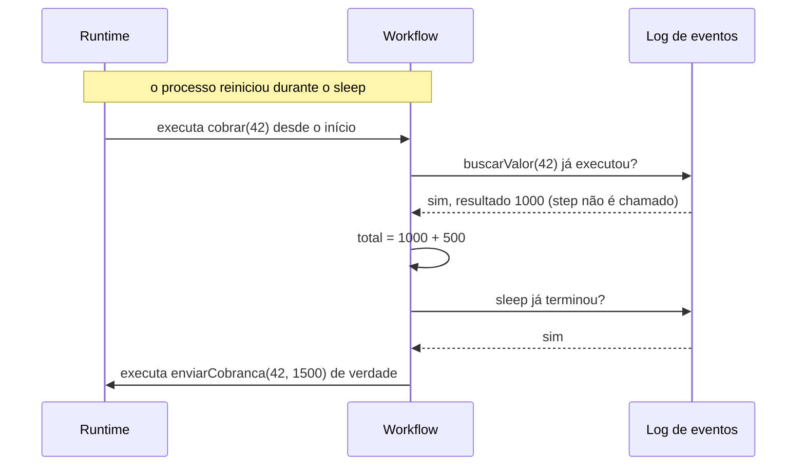
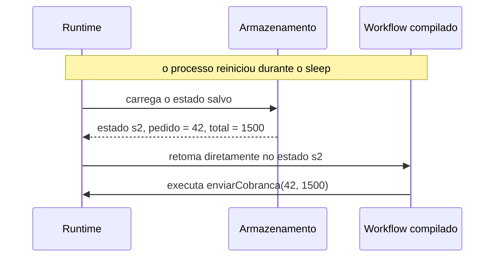
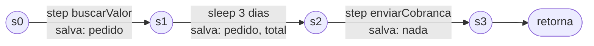
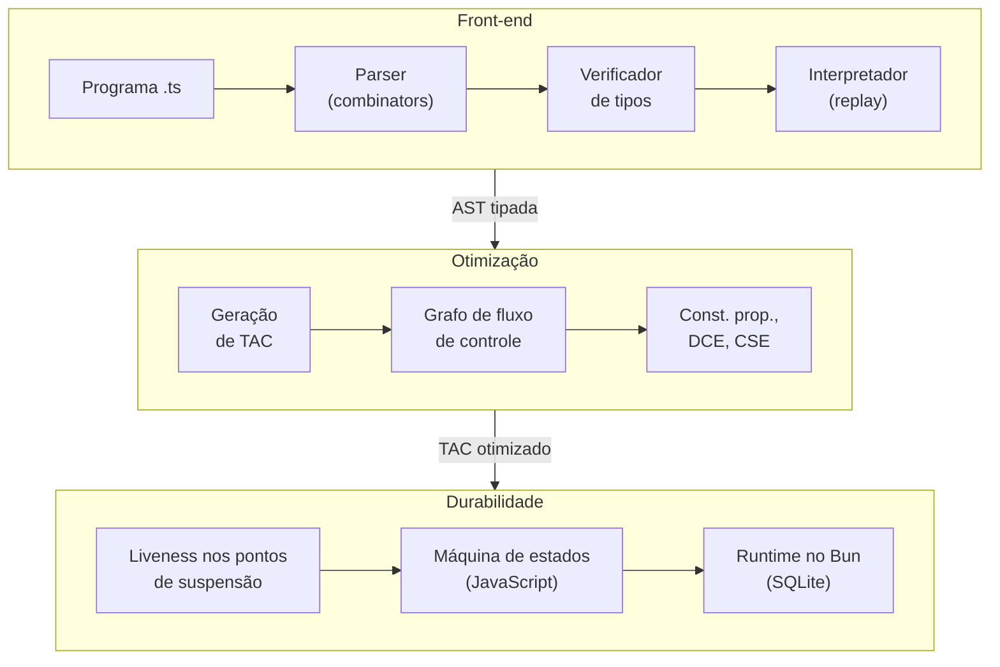

# Dormant: workflows duráveis compilados

> **Documento de design.** Descreve a linguagem, a tese e a arquitetura, e é atualizado conforme a implementação avança. Projeto desenvolvido na disciplina de Construção de Compiladores (CIn-UFPE, 2026.2); o plano de marcos está em `roadmap.md`.
>
> **Autor:** Arthur Brito

## 1. Resumo

O **Dormant** é um subconjunto sintático de TypeScript com semântica estendida para **workflows duráveis**: funções que podem pausar por horas ou dias e retomar exatamente de onde pararam, mesmo depois que o processo reinicia.

A proposta é que **o compilador transforme código escrito de forma linear em uma máquina de estados retomável**, usando análise de variáveis vivas sobre código de três endereços (TAC) para persistir apenas o estado necessário em cada pausa. O projeto percorre todas as etapas de um compilador:

- parser (com parser combinators);
- verificação de tipos;
- interpretação, com retomada por *replay*;
- representação intermediária;
- otimizações;
- geração de código, com retomada por *snapshot*.

## 2. Motivação

Trabalho como engenheiro de IA sênior na Trilha, onde lido diariamente com **workflows duráveis**, tanto em pipelines de processamento de dados quanto em agentes de IA generativa. Um workflow durável é uma função cuja execução precisa sobreviver a falhas: um processo que reinicia, um deploy no meio da execução, uma espera de três dias por um evento externo. Exemplos:

- um pipeline que dispara um agente de IA por documento, espera revisão humana dos casos duvidosos e consolida o resultado;
- um pipeline que processa milhares de lotes;
- uma cobrança que espera o pagamento por dias antes de mandar um lembrete.

Sistemas como **Temporal**, **Vercel Workflow**, **Cloudflare Workflows** e **Restate** resolvem esse problema em produção. Quis estudá-lo pelo lado do compilador: *o que um compilador consegue fazer por um workflow durável que uma biblioteca não consegue?*

Um workflow em Dormant é TypeScript comum, marcado com diretivas (como no Vercel Workflow):

```ts
async function buscarValor(pedido: int): Promise<int> {
  "use step";            // step: única forma de causar efeitos colaterais
  /* consulta um banco ou uma API */
}

async function enviarCobranca(pedido: int, total: int): Promise<boolean> {
  "use step";
  /* chama o gateway de pagamento */
}

export async function cobrar(pedido: int): Promise<string> {
  "use workflow";        // workflow: execução que sobrevive a reinícios
  const valor = await buscarValor(pedido);
  const total = valor + 500;
  await sleep(3 * DIA);  // pode pausar por dias; o processo pode morrer aqui
  const ok = await enviarCobranca(pedido, total);
  if (ok) { return "cobrado"; }
  return "falhou";
}
```

## 3. O problema central: como retomar?

Se o processo morre durante o `sleep`, como continuar a partir da linha seguinte? Existem duas estratégias.

### 3.1 Replay: reexecutar desde o início

O runtime guarda um **log** com o resultado de cada step concluído. Ao retomar, **executa o workflow novamente desde o início**: cada step já registrado devolve o resultado do log em vez de executar de novo.



É a estratégia do Temporal, do Vercel Workflow, do Cloudflare Workflows, do Restate e do Effect Workflow. Ela tem uma exigência forte: **o código do workflow precisa ser determinístico**. Se o replay seguir outro caminho (por causa de `Math.random()`, `Date.now()` ou de uma mudança no código), o histórico deixa de corresponder à execução. Por isso o Vercel Workflow executa os workflows numa VM com `Math.random()` e `Date.now()` controlados, e o Temporal acusa erros de não-determinismo.

### 3.2 Snapshot: salvar o estado e continuar dali

O runtime salva **em que ponto a execução parou** e **as variáveis ainda necessárias**. Ao retomar, carrega esse estado e segue em frente. Nada é reexecutado.



### 3.3 Comparação

| | **Replay** | **Snapshot** |
|---|---|---|
| Determinismo do workflow | Obrigatório | **Não é exigido**: cada trecho executa uma única vez |
| Custo de retomar | Cresce com o histórico (reler e reexecutar tudo) | Constante: carregar o estado atual |
| Execuções muito longas | Exigem limites de histórico e mecanismos de "recomeço" (ex.: *Continue-As-New* no Temporal) | Sem histórico para crescer |
| Mudar o código com execuções em andamento | O código novo precisa reproduzir o histórico antigo (*patching*/versionamento) | Migração explícita dos dados salvos |
| Liberdade do código | **Total**: qualquer construção da linguagem | **Restrita**: o que está vivo numa pausa precisa ser serializável |
| Observabilidade | **Gratuita**: o histórico é uma trilha de auditoria | Exige registro à parte |
| Onde está a complexidade | No runtime | No **compilador** |

Nenhuma das duas estratégias é melhor em geral: são pontos diferentes de um espaço de projeto.

## 4. Panorama e posicionamento

O **pi-durable** (Earendil, lançado com o Pi 1.0 em outubro de 2026) usa snapshot nas suas *tasks*: em vez de reexecutar código, grava a cada passo um checkpoint com a fase atual e os dados necessários, e ao retomar chama diretamente a fase registrada, sem exigir determinismo. O custo é que o programador precisa **escrever a máquina de estados à mão**: dividir a tarefa em fases nomeadas e decidir o que vai em cada checkpoint. Esquecer uma variável no checkpoint gera um erro que só aparece depois de uma retomada; salvar demais encarece o armazenamento e as migrações.

| | **Código linear** (fácil de escrever) | **Máquina de estados à mão** |
|---|---|---|
| **Replay** | Temporal, Vercel Workflow, Cloudflare Workflows, Restate, Effect Workflow; Code Mode do pi-durable | — |
| **Snapshot** | **Dormant: o compilador gera a máquina de estados** | tasks do pi-durable |

Desde a versão 1.2.0, o pi-durable também oferece um *Code Mode* durável: scripts lineares numa VM QuickJS, retomados por **replay** com determinismo imposto pela própria VM (relógio virtual, *seed* fixa). Ou seja, no pi-durable o replay aparece justamente no componente cujo estado fica dentro de uma VM opaca, enquanto as tasks, de estado explícito, usam checkpoint. Um compilador que conhece o programa e calcula as variáveis vivas consegue produzir esse estado explícito também para código linear.

O Vercel Workflow também tem, desde a versão 5.0, um caminho **híbrido experimental**: com o motor QuickJS, depois de muitos eventos, ele grava um snapshot da memória inteira da VM e, ao retomar, restaura a VM e faz replay só dos eventos posteriores. Esse snapshot é uma otimização, não a fonte da verdade (o log continua sendo), é opaco, só pode ser restaurado pelo mesmo build do motor e precisa ser criptografado, porque contém código e estado executável. O snapshot do Dormant é de outra natureza: gerado pelo compilador, contém só as variáveis vivas, é dado inspecionável e versionável, e é o próprio mecanismo de retomada.

O compilador de C# já faz uma transformação parecida com `async`/`await`: transforma o método numa máquina de estados e move para o objeto de estado apenas as variáveis locais que atravessam um `await`, decididas por análise de fluxo de dados. Mas essa máquina vive só em memória. O Dormant leva a mesma ideia para estados **persistidos**.

Uma biblioteca só consegue fazer snapshot se o programador escrever a máquina de estados; **uma linguagem consegue fazê-lo a partir de código linear**, porque o compilador:

1. **enxerga a função inteira** e pode dividi-la em estados em cada ponto de suspensão;
2. **calcula as variáveis vivas** (*liveness*) em cada ponto e salva exatamente o necessário;
3. **verifica estaticamente** que tudo o que é salvo é serializável e que efeitos colaterais só ocorrem em steps: regras que os sistemas de replay só conseguem impor em tempo de execução.

Em uma frase: *a ergonomia do Vercel Workflow (código linear) com a semântica do pi-durable (snapshot), e o compilador fazendo a ponte.*

**Fronteira com a durabilidade de agentes.** O Dormant não substitui a durabilidade do *loop* de um agente de IA (modelo → ferramenta → modelo). Ali o estado vivo já é dado serializado, a própria conversa, e ferramentas como o OpenCode 2 o tornam durável gravando o histórico num log de eventos e relendo-o ao retomar, sem análise de variáveis. O Dormant torna durável o **código que orquestra** agentes e etapas, cujo estado vive em variáveis locais (índices de laço, acumuladores, decisões de desvio, aprovações) e precisa ser descoberto pelo compilador.

## 5. Como o compilador faz isso

No exemplo da Seção 2, os pontos de suspensão são as chamadas de step e o `sleep`. A análise de *liveness* responde, para cada ponto, quais variáveis **ainda podem ser lidas depois dele**:

| Ponto de suspensão | Variáveis vivas (salvas) | Não salvas |
|---|---|---|
| `await buscarValor(pedido)` | `pedido` | — |
| `await sleep(3 * DIA)` | `pedido`, `total` | `valor` (não é mais lida) |
| `await enviarCobranca(pedido, total)` | — | `pedido`, `total` |

A função vira uma máquina de estados em que cada transição atravessa um ponto de suspensão e persiste apenas as variáveis vivas:



Um esboço do JavaScript gerado (o formato exato será definido na Entrega 4; ver `roadmap.md`):

```js
export const cobrar = workflow({
  s0: ({ pedido }) =>
    callStep("buscarValor", [pedido], { next: "s1", save: { pedido } }),
  s1: ({ pedido }, valor) => {
    const total = valor + 500;
    return sleepFor(3 * DIA, { next: "s2", save: { pedido, total } });
  },
  s2: ({ pedido, total }) =>
    callStep("enviarCobranca", [pedido, total], { next: "s3", save: {} }),
  s3: (_, ok) => done(ok ? "cobrado" : "falhou"),
});
```

As otimizações clássicas ganham um efeito visível: a eliminação de código morto e a propagação de constantes **reduzem o conjunto de variáveis vivas**, e portanto o estado persistido em cada pausa.

## 6. A linguagem

Todo compilador envolve três linguagens com papéis diferentes. No Dormant:

| Papel | Linguagem |
|---|---|
| **Fonte** (o que o programador escreve) | Dormant: subconjunto de TypeScript com as diretivas `"use workflow"` / `"use step"` |
| **Implementação** (em que o compilador é escrito) | TypeScript, executado no Bun |
| **Alvo** (o que o compilador gera) | JavaScript: cada Workflow vira uma máquina de estados (fases + checkpoint com as variáveis vivas), executada no Bun por um runtime mínimo que agenda os `sleep`s e persiste o estado em SQLite |

Entre a fonte e o alvo fica o TAC: o caminho de compilação é Dormant → AST → TAC → otimizações e liveness → JavaScript. O interpretador não gera código; executa a AST diretamente.

| Questão | Definição |
|---|---|
| **Propósito** | Específico: orquestração durável, sobre uma base de propósito geral |
| **Paradigma** | Imperativo |
| **Sistema de tipos** | Estático; anotações obrigatórias em parâmetros e retornos de funções |
| **Inspiração sintática** | TypeScript: todo programa Dormant é TypeScript válido |
| **Tipos básicos** | `int`, `float`, `boolean`, `string` e listas (`int[]`, `string[]`, …) |
| **Comandos** | `let`/`const`, `if`/`else`, `while`, `return`, chamadas; `await` de steps e `sleep` no nível de comando do workflow |
| **Expressões** | Literais, operadores aritméticos, relacionais e lógicos, chamadas de função, literais e indexação de listas |
| **Prelúdio (stdlib)** | `sleep`, unidades de tempo (`SEGUNDO`, `MINUTO`, `HORA`, `DIA`), `console.log` e declarações de `int`/`float` como aliases de `number` |

### 6.1 Subconjunto sintático, semântica estendida

O Dormant não é um *superset* de TypeScript (isso exigiria implementar a linguagem inteira). É um **subconjunto**: todo programa Dormant é TypeScript válido, mas nem todo TypeScript é Dormant. O que muda é a **semântica**: o mesmo texto, compilado pelo Dormant, se torna durável.

A compatibilidade é buscada em três níveis:

| Nível | Significado | Como é obtido |
|---|---|---|
| **Sintático** | O parser do TypeScript aceita o arquivo | Diretivas são strings; o resto é TypeScript comum |
| **De tipos** | O `tsc` aceita o arquivo sem erros | Prelúdio com `type int = number`, `type float = number`, `sleep` etc. |
| **Semântico** | Sem reinícios, executar no Bun dá o mesmo resultado | Base dos **testes diferenciais** (Seção 9) |

Uma decisão em aberto decorre do terceiro nível: a semântica de `int` não pode divergir do `number` do JavaScript (por exemplo, em `7 / 2`). A proposta inicial é que `/` sempre produza `float`, com divisão inteira por uma função do prelúdio (`idiv`).

### 6.2 Regras específicas do verificador de tipos

Além das regras usuais (tipos de operadores, chamadas, retornos), o verificador impõe:

1. **Efeitos colaterais, inclusive I/O, apenas dentro de steps.** O corpo de um workflow só calcula e chama steps.
2. **`await` apenas de steps e de `sleep`**, e apenas no nível de comando do workflow.
3. **Tudo o que estiver vivo num ponto de suspensão deve ser serializável.** Na v1 todos os tipos são; a regra passa a ter efeito quando a linguagem crescer (Seção 8).

## 7. Arquitetura



- **Implementação:** TypeScript sobre o Bun, com uma biblioteca própria de parser combinators. Os motivos:
  - o runtime durável e o código gerado já são JavaScript/Bun, então compilador, runtime e testes compartilham uma única linguagem;
  - os testes diferenciais executam o mesmo programa no Bun sem nenhuma ponte entre linguagens;
  - o esforço de aprendizado vai para compiladores e durabilidade, e não para uma nova linguagem de implementação.

  Rust foi a principal alternativa considerada (é a linguagem do MiniC, a linguagem de referência da disciplina); sem experiência prévia com Rust, aprendê-lo junto com os conceitos de compiladores aumentaria bastante a complexidade do projeto.
- **Alvo:** JavaScript, executado no Bun por um runtime mínimo que agenda os `sleep`s e persiste o estado.
- **TAC (código de três endereços):** cada instrução tem no máximo uma operação, o que torna explícitos os valores intermediários.
- **CFG (grafo de fluxo de controle):** organiza o TAC em blocos básicos ligados pelos saltos possíveis. É sobre ele que rodam as análises de fluxo de dados (liveness, propagação de constantes).

## 8. Escopo da primeira versão

**Fora da primeira versão:**

- `await` dentro de laços ou blocos aninhados;
- `try`/`catch`;
- steps em paralelo (o `await` é uma pausa sequencial, não concorrência);
- objetos e classes;
- closures;
- generics e union types;
- módulos;
- versionamento de workflows em andamento.

**Closures** são o corte menos óbvio. Para salvar uma closure viva numa pausa seria preciso salvar o seu código, que pode mudar entre versões, e as variáveis que ela captura, que podem ser compartilhadas com outras closures (salvá-las separadamente criaria cópias e mudaria o comportamento). O caminho de evolução já está mapeado:

1. Permitir closures, proibindo apenas que uma closure esteja **viva num ponto de suspensão**. A própria análise de liveness verifica isso, numa regra análoga à exigência de `Send` para valores mantidos através de um `.await` em Rust.
2. Depois, aplicar **defuncionalização** (Reynolds) para torná-las serializáveis.

## 9. Estratégia de testes

- **Testes do parser e do verificador de tipos:** programas válidos e inválidos, com as mensagens de erro esperadas.
- **Testes diferenciais:** o mesmo programa executado (a) no Bun como TypeScript comum, (b) no interpretador do Dormant e (c) compilado; as saídas devem coincidir quando não há reinícios.
- **Testes de retomada:** para cada ponto de suspensão de um programa, interromper a execução naquele ponto, retomar, e verificar que a saída final é a mesma de uma execução sem interrupções, tanto no replay quanto no snapshot.

## 10. Referências

**Sistemas de workflows duráveis**

- Temporal — documentação: <https://docs.temporal.io>
- Vercel Workflow — como funciona a transformação de código: <https://workflow-sdk.dev/docs/how-it-works/code-transform>
- Cloudflare Workflows — regras de workflows: <https://developers.cloudflare.com/workflows/build/rules-of-workflows>
- Restate — execução durável: <https://docs.restate.dev/concepts/durable_execution>
- pi-durable (Earendil): <https://github.com/earendil-works/pi> e <https://earendil.com/posts/pi-durable/>
- Effect — workflows e cluster: <https://effect.website>
- OpenCode 2 (Anomaly) — durabilidade de sessões de agente por log de eventos: <https://anoma.ly/notes/opencode-2-0/>

**Transformação de código em máquinas de estados**

- Compilador de C# (Roslyn) — geração de máquinas de estados para `async`/`await`: <https://github.com/dotnet/roslyn>
- regenerator — transformação de generators e `async` em máquinas de estados em JavaScript: <https://github.com/facebook/regenerator>
- Servidor web do Racket — continuações serializáveis geradas pelo compilador.

**Livros**

- K. Cooper, L. Torczon. *Engineering a Compiler*.
- F. Nielson, H. R. Nielson, C. Hankin. *Principles of Program Analysis*.
- B. Pierce. *Types and Programming Languages*.
