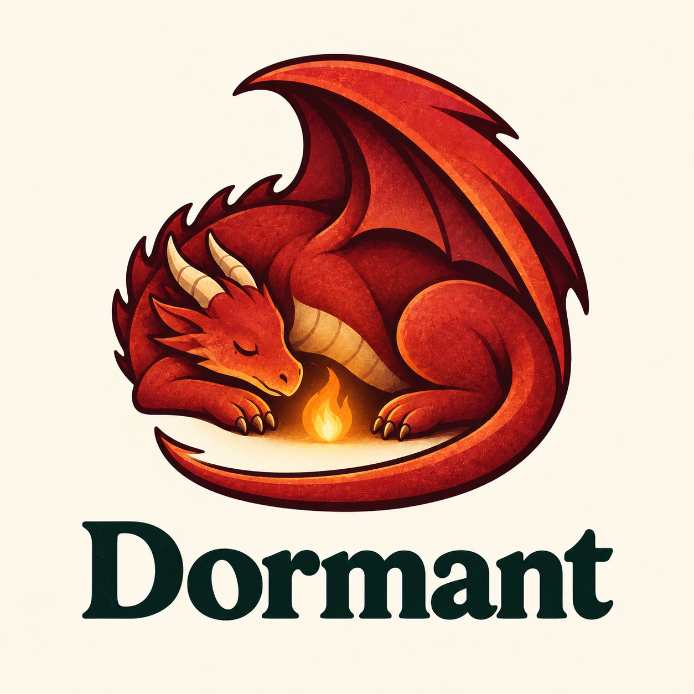

# Identidade visual

## Logo escolhida

A identidade do Dormant usa um dragão vermelho adormecido, enrolado ao redor de uma pequena chama. O desenho tem textura de impressão, fundo creme e o nome da linguagem em letras escuras com serifa.

O arquivo original aprovado está em [`assets/branding/dormant-logo.png`](../assets/branding/dormant-logo.png). A imagem foi criada com uma ferramenta de geração de imagens por IA e inclui o mascote e o nome Dormant. A cabeça, o pescoço e a cauda têm contornos separados, e o elemento central tem a forma de uma chama de fogo.

## Variáveis como chaminhas

A ideia para desenvolver essa identidade é representar as variáveis como pequenas chamas que o dragão sopra. As chamas podem nascer, se multiplicar, se apagar e interagir entre si ou com o próprio dragão. Elas fazem parte da representação visual do programa, em vez de serem apenas um efeito decorativo ao redor do mascote.

O dragão teria um papel nessa dinâmica. Uma possibilidade é representar o compilador, mas essa correspondência ainda está em aberto. A relação entre cada comportamento das chamas e as operações da linguagem também precisa ser definida.

Uma possibilidade para explorar a durabilidade é mostrar o dragão adormecendo enquanto protege as chamas das variáveis vivas, cujos valores precisam ser preservados para a retomada. Essa associação é uma proposta visual, não uma definição da semântica da linguagem.

## Continuidade

A logo registra a direção visual escolhida e permanece como referência para as novas mídias. O conjunto passa a prever ilustrações estáticas e GIFs animados com o mesmo dragão e a dinâmica das chamas descrita abaixo.

Nas próximas versões, preservar o dragão vermelho, o aspecto adormecido e as chamas com aparência de fogo. A anatomia deve continuar legível, com cabeça, pescoço, patas, asas e cauda distinguíveis, inclusive quando a composição ficar mais compacta.

## GIFs do dragão

As animações devem desenvolver a proposta das variáveis como chaminhas, mantendo o caráter tranquilo do mascote. Cada GIF deve mostrar uma ação simples, compreensível sem legenda.

| Mídia proposta | Ação | Encerramento |
| --- | --- | --- |
| `dormant-sleeping.gif` | O dragão dorme com respiração discreta enquanto três pequenas chamas tremulam protegidas entre suas patas. | Loop contínuo; nenhuma chama se apaga. |
| `dormant-embers.gif` | O dragão desperta levemente e sopra pequenas chamas, que nascem e passam a interagir. | Termina com as chamas acesas; evitar reinício brusco. |
| `dormant-resume.gif` | Com as chamas já presentes, o dragão adormece protegendo-as e depois desperta; as mesmas chamas continuam vivas. | Retoma a composição inicial sem recriar as chamas. |

O terceiro GIF ilustra a continuidade das variáveis vivas entre um Ponto de suspensão e a retomada. Não deve sugerir que todas as variáveis são preservadas, que os valores se perdem durante o sono ou que a retomada exige repetir os Steps já concluídos. As cenas são metáforas visuais; o papel do dragão como compilador continua em aberto.

### Direção de produção

- Usar `assets/branding/dormant-logo.png` como referência visual em todas as gerações.
- Preservar a paleta vermelha e alaranjada, a textura de impressão e o fundo creme.
- Manter cabeça, pescoço, patas, asas e cauda distinguíveis durante toda a animação, sem deformações ou membros extras.
- Manter a câmera fixa e os movimentos suaves. Caso o nome Dormant apareça, preservar sua tipografia e deixá-lo imóvel.
- Preferir clipes curtos com uma única ação. Usar loop apenas quando ele não contradisser a continuidade representada.
- Exportar um PNG estático de cada animação para contextos sem movimento. Em páginas que suportem essa escolha, respeitar `prefers-reduced-motion` exibindo o PNG.
- Guardar os arquivos finais em `assets/branding/`. Só inserir links de exibição no README e neste documento depois que os arquivos existirem.

### Geração com GPT Image 2.6

O GPT Image 2.6 é a opção prevista para gerar os GIFs a partir da logo aprovada. A documentação oficial descreve a saída animada pelo Image API com `output_format="gif"`:

- [Guia de geração de imagens](https://developers.openai.com/api/docs/guides/image-generation)
- [Guia de prompts de imagem](https://developers.openai.com/api/docs/guides/image-prompting)

Prompt-base para a primeira mídia:

> Anime a logo de referência como um GIF curto em loop contínuo. Preserve o mesmo dragão vermelho adormecido, a anatomia legível, a textura de impressão, o fundo creme e o nome Dormant imóvel. O dragão protege três pequenas chamas vivas entre suas patas. Anime somente uma respiração discreta e o tremular suave do fogo. As três chamas permanecem acesas durante todo o loop. Não movimente a câmera, não deforme letras, não acrescente membros e não transforme a cena em um storyboard estático.

### Estado da produção e validação

Os GIFs acima estão planejados, ainda não adicionados ao repositório. Uma tentativa nesta sessão retornou um PNG estático, portanto não conta como entrega de animação nem como validação do suporte a GIF na ferramenta usada.

Antes de publicar cada arquivo, verificar que ele contém múltiplos frames e reproduz movimento, revisar a anatomia e a consistência das chamas ao longo do clipe, conferir a transição do loop quando houver e otimizar o tamanho sem comprometer a leitura. Manter a logo original aprovada como alternativa estática.
