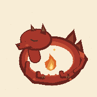

# Identidade visual

## Logo escolhida

A identidade do Dormant usa um dragão vermelho adormecido, enrolado ao redor de uma pequena chama. O desenho tem textura de impressão, fundo creme e o nome da linguagem em letras escuras com serifa.

O arquivo original aprovado está em [`assets/branding/dormant-logo.png`](../assets/branding/dormant-logo.png). A imagem foi criada com uma ferramenta de geração de imagens por IA e inclui o mascote e o nome Dormant. A cabeça, o pescoço e a cauda têm contornos separados, e o elemento central tem a forma de uma chama de fogo.

## Variáveis como chaminhas

A ideia para desenvolver essa identidade é representar as variáveis como pequenas chamas que o dragão sopra. As chamas podem nascer, se multiplicar, se apagar e interagir entre si ou com o próprio dragão. Elas fazem parte da representação visual do programa, em vez de serem apenas um efeito decorativo ao redor do mascote.

O dragão teria um papel nessa dinâmica. Uma possibilidade é representar o compilador, mas essa correspondência ainda está em aberto. A relação entre cada comportamento das chamas e as operações da linguagem também precisa ser definida.

Uma possibilidade para explorar a durabilidade é mostrar o dragão adormecendo enquanto protege as chamas das variáveis vivas, cujos valores precisam ser preservados para a retomada. Essa associação é uma proposta visual, não uma definição da semântica da linguagem.

## Mídias animadas do dragão

Além da logo estática aprovada, o Dormant tem dois **estudos animados em GIF** que exploram a ideia das variáveis como pequenas chamas. Eles são ilustrações conceituais em estilo simplificado/pixelado, **não substituem a logo** e não afirmam uma semântica já implementada na linguagem.

| Sono e proteção | Variáveis como chaminhas |
| --- | --- |
|  |  |
| `dormant-dragon-sleep.gif` · 10 quadros, 150 ms/quadro, loop de 1,5 s | `dormant-dragon-flames.gif` · 16 quadros, 150 ms/quadro, loop de 2,4 s |

Os dois arquivos têm 192 × 192 px, repetição infinita e fundo creme. O primeiro transmite permanência durante o repouso; o segundo sugere chamas nascendo e se multiplicando. São **metáforas visuais**, não especificações sobre a persistência, a execução ou a multiplicação real de variáveis.

### Direção para novas versões com Images 2.6

O **GPT-Image-2.6 Sunburst** permite gerar GIFs diretamente pelo endpoint `POST /v1/images/generations`, com `output_format: "gif"`, `frame_count` e `frame_duration_ms`. O endpoint de edição de imagens **não** aceita GIF como formato de saída; portanto, não presumir que basta enviar a logo ao endpoint de edição para animá-la. Consultar a [documentação oficial](https://developers.openai.com/api/docs/guides/image-generation) antes de produzir variações.

Brief visual para futuras animações mais fiéis à logo aprovada:

> Dragão vermelho adormecido, enrolado ao redor de uma pequena chama acesa, em estilo de gravura impressa artesanal, textura de tinta, fundo creme. Cabeça, pescoço, patas, asas e cauda claramente distinguíveis. Câmera fixa; movimento delicado de respiração e de chamas protegidas. Loop contínuo e sem salto, terminando na mesma composição do início. Preservar identidade, anatomia, paleta e estilo em todos os quadros. Não incluir texto, marcas adicionais ou novos personagens.

Para variações com múltiplas chamas, animar seu surgimento e retorno sem sugerir que o Workflow de fato duplica variáveis. Priorizar um loop breve de 9–16 quadros, 150–200 ms por quadro, sujeito a validação visual. Revisar continuidade quadro a quadro e comparar o resultado com a imagem canônica. Não rotular os dois estudos atuais como criações do Images 2.6.

### Regras de uso

- Em documentação e identidade oficial, **a logo PNG original continua sendo a referência**; os GIFs são complementares.
- Não inserir animação em lugar de explicação técnica. Para durabilidade, o diagrama ou o texto sobre Checkpoints continua sendo a fonte precisa.
- Em interfaces, respeitar `prefers-reduced-motion`: mostrar uma imagem estática (preferencialmente a logo PNG) para quem solicita menos movimento.
- Manter a animação legível em tamanhos pequenos, com fundo creme e contraste adequado; evitar piscadas abruptas.
- Se um GIF for revisado ou regenerado, atualizar este inventário e confirmar duração, qualidade do loop e coerência com a logo.

## Continuidade

A logo registra a direção visual escolhida. As dinâmicas das chamas agora também têm estudos animados. Isso documenta a linguagem visual, sem introduzir semântica nova nem implementar qualquer comportamento no compilador.

Nas próximas versões, preservar o dragão vermelho, o aspecto adormecido e as chamas com aparência de fogo. A anatomia deve continuar legível, com cabeça, pescoço, patas, asas e cauda distinguíveis, inclusive quando a composição ficar mais compacta.
